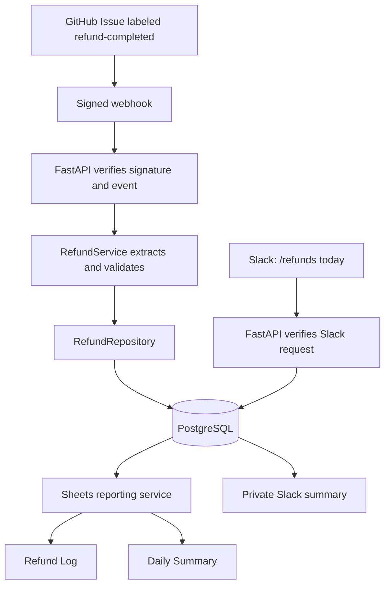

# RefundOps

RefundOps automates the reporting work that follows a completed customer refund.
An analyst records refund details in a support ticket and applies a completion
label. The backend validates the event, stores the refund in PostgreSQL, updates
two Google Sheets reports, and exposes refund statistics in Slack.

This portfolio project uses GitHub Issues as a simulated CRM. It records
completed refunds; it does not issue payments. Use synthetic customer data.

## Status

**Working local demo; development paused at this checkpoint.** GitHub delivery,
PostgreSQL persistence, duplicate protection, Google Sheets synchronization, and
Slack `/refunds today` have been verified live. The automated suite has **62
passing tests**. Deployment and remaining features are listed below.

## Architecture



ngrok forwards public HTTPS requests to the local server. PostgreSQL is the
system of record. Sheets contains derived reports; Slack queries PostgreSQL.

## Features

- GitHub and Slack signature verification before processing requests.
- Refund extraction and Pydantic validation, with exact decimal amounts.
- PostgreSQL persistence and unique delivery IDs and ticket IDs.
- Refund listing, Toronto-day totals, and all-time analyst statistics.
- Atomic Google Sheets updates for Refund Log and Daily Summary.
- Idempotent report refresh and a manual recovery command.
- Private Slack `/refunds today` summaries with bounded response time.
- Contextual logs and tests for validation, failures, and duplicate handling.

## Folder architecture

```text
app/
├── main.py                 Creates FastAPI and registers routers
├── api/                    HTTP requests and responses
├── core/                   Environment configuration
├── models/                 Pydantic input and response schemas
├── services/               Refund workflow and integration logic
├── repositories/          SQL reads and writes
└── db/                     Connection, SQL schema, and migration
scripts/                    Database setup and manual reporting commands
tests/                      Automated tests
docs/                       Learning, setup, and debugging guides
```

The API handles HTTP, the service coordinates business operations, the
repository executes SQL, and PostgreSQL stores records. Pydantic models
validate data; the SQL schema defines storage. A repository in `app/` means
database-access code, not the GitHub code repository.

## Local setup

Prerequisites: Python 3.13 (tested), a running PostgreSQL server, and a database
named `refundops`. pgAdmin is optional for inspecting records.

```bash
python3 -m venv .venv
source .venv/bin/activate
python -m pip install -r requirements.txt
python -m scripts.check_database
python -m scripts.init_database
```

The database scripts prompt for a password if necessary. Those prompts do not
configure the server's environment. The app reads exported variables; **it does
not automatically load `.env` files**. See `.env.example` for placeholders.

| Variable | Purpose |
| --- | --- |
| `PGHOST` | Database host; default `localhost` |
| `PGPORT` | Database port; default `5432` |
| `PGDATABASE` | Database name; default `refundops` |
| `PGUSER` | Database user; default `postgres` |
| `PGPASSWORD` | Database password for the server process |
| `GITHUB_WEBHOOK_SECRET` | Shared GitHub webhook secret |
| `GOOGLE_APPLICATION_CREDENTIALS` | Absolute path to service-account JSON key |
| `GOOGLE_SHEETS_SPREADSHEET_ID` | Reporting spreadsheet ID |
| `SLACK_SIGNING_SECRET` | Slack app Signing Secret |

In bash, enter runtime secrets at hidden prompts, then start the server:

```bash
read -s -p 'PostgreSQL password: ' PGPASSWORD
export PGPASSWORD
read -s -p 'GitHub webhook secret: ' GITHUB_WEBHOOK_SECRET
export GITHUB_WEBHOOK_SECRET
python -m uvicorn app.main:app --reload
```

The same terminal must contain the Google and Slack settings when those
integrations are used. Enter values without quotation marks at hidden prompts.
Open http://127.0.0.1:8000/docs for interactive API documentation.

For an older database created before ticket uniqueness, run
`python -m scripts.migrate_unique_ticket`. It keeps the earliest refund per
ticket and archives later copies before adding the unique constraint. All
operations commit or roll back together. Fresh tables use the current schema.

## GitHub demo

Create a synthetic issue with these plain-text fields:

```text
Customer ID: CUST-DEMO-001
Refund Amount: 29.99
Refund Reason: Service outage
Analyst: analyst_07
```

Create the `refund-completed` label. Run `ngrok http 8000`. Under repository
Settings → Webhooks, configure:

- URL: your ngrok HTTPS address plus `/webhooks/github`.
- Content type: `application/json`.
- Secret: the same value configured in FastAPI.
- Events: **Issues**.

Apply the label. A configured successful response looks like:

```json
{"status":"saved","ticket_id":1,"delivery_id":"example-delivery","record_id":1,"reporting_status":"synced"}
```

Redelivery or relabeling the same ticket returns `duplicate` and the existing
record ID. It does not overwrite the original refund. Record IDs can have gaps
because attempted inserts consume sequence values.

## Google Sheets and Slack

Follow [Google Sheets setup](docs/google-sheets-setup.md) to enable the Sheets
API and share a dedicated spreadsheet with the service account. The app manages
A:G in **Refund Log** and A:C in **Daily Summary**, overwriting those values on
each sync. Summary dates use America/Toronto. Amounts are literal text; Python
Decimal arithmetic computes totals. To refresh reports manually:

```bash
python -m scripts.sync_sheets
```

Follow [Slack setup](docs/slack-setup.md) to install `/refunds` with Request URL
ending in `/slack/commands`. **Disable Socket Mode** because our backend uses
HTTP. Export the Signing Secret before starting FastAPI, then run:

```text
/refunds today
```

The response is visible only to the invoking user. No bot token is required in
Python for this direct slash-command response.

`/refunds` without an argument also returns today's summary.

## API endpoints

| Method | Path | Behavior |
| --- | --- | --- |
| POST | `/webhooks/test` | Acknowledge JSON; no storage |
| POST | `/webhooks/test/refund` | Validate and echo; no storage |
| POST | `/webhooks/github` | Verify, save, and synchronize reports |
| GET | `/refunds` | Newest records with limit (1–100) and offset (0 or greater) |
| GET | `/stats/today` | Toronto-day count and total, date, and timezone |
| GET | `/stats/analysts` | All-time totals grouped by analyst |
| POST | `/slack/commands` | Signed `/refunds today` request |

Money is returned as JSON strings to preserve precision. The handling status
`saved` or `duplicate` is separate from the refund business status `completed`.

## Testing and verification

```bash
python -m unittest discover -v
```

The 62 tests cover schemas, extraction, signatures, persistence result handling,
pagination, Toronto date and daylight-saving boundaries, report batches, Slack
commands, and error responses. External systems are mocked; these are not
automated live PostgreSQL, Google, or Slack integration tests.

Live checks completed during development:

- Completion events saved refunds visible in pgAdmin and `/refunds`.
- Redelivery and relabeling returned duplicate without additional active rows.
- A second ticket returned saved with reporting_status synced.
- Slack returned the matching Toronto-day count and amount.

## Limits and remaining work

- Deployment is pending; the demo depends on the laptop and ngrok.
- Reporting GET endpoints lack authentication and are for synthetic demo data.
- One source GitHub repository and one demo Slack workspace are assumed.
- Amounts assume a single currency; currency fields and conversion are absent.
- One refund per ticket; partial refunds and corrections need a separate workflow.
- Sheets refreshes all rows synchronously under an advisory lock. Failures
  preserve the refund and return reporting_status failed. Retries are manual or
  triggered by another valid event; there is no durable reporting worker.
- Remaining plan items: Slack count/total/analyst commands, CSV ticket importer,
  ticket lookup endpoint, automated database integration tests, and deployment.

## Learning and debugging

- [Rebuild learning guide](docs/learning-guide.md): concepts, exercises, and checks.
- [Debugging notes](docs/debugging-notes.md): observed failures and recovery.
- [Google Sheets setup](docs/google-sheets-setup.md).
- [Slack setup](docs/slack-setup.md).

Keep keys in the ignored `credentials/` folder or outside the project.
Environment files, Python environments, and generated caches are excluded from
version control. No credentials are required to run the mocked automated suite.
